# 🛡️ Automated Ransomware Recovery & Rollback: Curated Ecosystem

<p align="center">
  
</p>

<p align="center">
  <a href="https://github.com/ishandutta2007/Awesome-Awesome-Awesome"></a><a href="https://discord.gg/jc4xtF58Ve"></a>
  <a href="https://github.com/ishandutta2007/Awesome-Automated-Ransomware-Recovery-Rollback/stargazers"></a>
  <a href="https://github.com/ishandutta2007/Awesome-Automated-Ransomware-Recovery-Rollback/network/members"></a>
  <a href="https://github.com/ishandutta2007/Awesome-Automated-Ransomware-Recovery-Rollback/issues"></a>
  <a href="https://github.com/ishandutta2007/Awesome-Automated-Ransomware-Recovery-Rollback/blob/main/LICENSE"></a>
  <a href="https://github.com/ishandutta2007"></a>
</p>

---

## ⚡ Top Automated Ransomware Recovery & Rollback Ecosystem

> **A Comprehensive, Production-Grade Guide and Curated Index of Enterprise SaaS Platforms & Open-Source Tools for Real-Time Ransomware Detection, Clean Room Isolation, Immutable Backups, and Zero-Downtime Rollback Orchestration.**

Whether you are an **SRE**, **Security Operations Engineer (SecOps)**, **Cloud Architect**, or **Cyber Resilience Officer**, surviving modern cryptoviral extortion demands automated, verified, and immutable recovery pipelines. This index tracks category-defining **SaaS solutions** alongside active **open-source projects** that prevent lateral reinfection, automate point-in-time rollbacks, and guarantee safe workload restoration.

---

## 📑 Table of Contents
- [📊 Sector Overview & Market Dynamics](#-sector-overview--market-dynamics)
- [☁️ Enterprise SaaS & Hosted Platforms](#️-enterprise-saas--hosted-platforms)
- [🔓 Open-Source GitHub Projects](#-open-source-github-projects)
- [🏗️ Blueprint Architecture: Zero-Trust Clean Recovery](#️-blueprint-architecture-zero-trust-clean-recovery)
- [🤝 How to Contribute](#-how-to-contribute)
- [☕ Support](#-support)
- [📈 Star History](#-star-history)
- [⚠️ Disclaimer](#️-disclaimer)

---

## 📊 Sector Overview & Market Dynamics

The global cyber resilience, ransomware recovery, and protection market is valued at approximately **$7B to $32B** (with recovery-specific cyber-vault and clean-room software accounting for ~$7B–$10.6B) and is projected to surge past **$28B to $136B+ by 2035** at an accelerating compound annual growth rate (**CAGR of ~14.9%–16.2%**). 

The industry exhibits a **moderately concentrated core surrounded by a highly specialized, fragmented perimeter**:
- **The Concentrated Core**: Mission-critical enterprise data estates and tier-one infrastructure are anchored by enterprise titans—such as **IBM**, **Rubrik**, **Veeam**, **Cohesity**, and **Commvault**—providing end-to-end WORM storage, inline hardware machine learning, continuous journaled replication, and automated isolated recovery environments (IRE).
- **The Dynamic Perimeter**: Rapid innovations in cloud-native workloads, Kubernetes-native snapshotting, deception honeypots, canary token triggers, and file-system rollback agents are spearheaded by focused SaaS innovators (e.g., Datto, Druva, HYCU) and open-source frameworks.

---

## ☁️ Enterprise SaaS & Hosted Platforms

The following enterprise platforms specialize in orchestrated cyber recovery, automated clean rooms, and immutable workload restore.

| Platform | Valuation / Scale | Starting Price | Free Tier / Trial Limits | Description |
| :--- | :--- | :--- | :--- | :--- |
| **[IBM FlashSystem Cyber Resilience](https://www.ibm.com/)** | ~$235B Market Cap (NYSE: IBM) | Starting at ~$10,000–$15,000 (entry-level 5015/5045 hardware array) | 14-day zero-cost on-premises test drive hardware loan; online remote PoC access | FlashCore Module (FCM) uses hardware-based ML models to detect ransomware encryption in under 1 minute; immutable isolated Safeguarded Copies enable rapid restoration with IBM Power Cyber Vault for sub-minute recovery [citation:10]. |
| **[Rubrik Surgical Recovery](https://www.rubrik.com/)** | ~$22B Market Cap (NYSE: RBRK; $1.46B ARR) | Starting at ~$57,000/year (or ~$3–$6/user/month for M365; ~$80–$200/TB/year for Cloud Vault) | 30-day guided SaaS trial (workload-capped evaluation through sales representative) | Recovers the most recent compromised snapshot clean—quarantining encrypted or suspect files without rolling back unimpacted data to stale recovery points; fail-closed architecture for VMware VMs and AWS EC2 [citation:2]. |
| **[Veeam Ransomware Recovery](https://www.veeam.com/)** | ~$15B Valuation ($2B+ ARR) | Starting at $95/workload/year (Veeam Data Platform Essentials 5-instance pack at $475/year) | Permanently free Community Edition (up to 10 workloads, full core backup); 30-day fully functional enterprise trial | Combines immutable/air-gapped object storage, inline threat detection, Recon Scanner (MITRE ATT&CK mapping), and Clean Rooms (DataLabs/SureBackup) for validated automated recovery [citation:14]. |
| **[Cohesity Clean Room](https://www.cohesity.com/)** | ~$7B–$8B Valuation ($1.6B+ Pro Forma ARR post-Veritas) | Starting at ~$29,100/year on AWS Marketplace (DataProtect as a Service baseline ~10 BETB) | 30-day free trial of Cohesity DataProtect as a Service via cloud marketplaces | Isolated recovery environment with threat scanning, anomaly detection, and RecoveryAgent blueprints; Nutanix integration provides automated clean room instantiation and Flow-based microsegmentation [citation:4][citation:15]. |
| **[Commvault Cleanroom Recovery](https://www.commvault.com/)** | ~$6.8B Market Cap (NASDAQ: CVLT; $1.1B+ ARR) | Starting at $1.70/user/month (M365 backup) / $58.50/TB/month (Cleanroom Recovery sold in 10TB FETB packs) | 30-day full-feature free trial (self-service access to Commvault Cloud and Cleanroom Recovery, no credit card required) | On-demand secure isolated cloud environment with automated cleanroom setup, Azure/AWS threat scanning, and integrated runbooks for one-click orchestration of network, VM, and security controls [citation:5]. |
| **[Datto Ransomware Detection](https://www.datto.com/)** | $6.2B Acquisition Valuation (by Kaseya) | Starting at ~$2.00–$3.00/user/month (Datto SaaS Protection via MSP channels) | 14-to-30 day sandbox free trial (provisioned evaluation tenant via MSP / sales onboarding) | Workplace Security Detection & Management uses behavioral analysis and Symantec Endpoint Protection to detect ransomware, auto-quarantine infected devices, halt cloud sync, and execute single-click file revision rollback [citation:7]. |
| **[Acronis Cyber Protect](https://www.acronis.com/)** | ~$3.5B Valuation ($400M+ Revenue; majority owned by EQT) | Starting at $85.00/workstation/year (Standard business edition) | 30-day full-access free trial (up to evaluation device capacity across cloud and local workloads) | Active Protection engine with behavior-based heuristic ransomware detection, backup cache self-defense, and automated file-level rollback of encrypted assets; monitors mapped SMB network shares and NAS arrays [citation:6]. |
| **[Druva Cyber Recovery Runbooks](https://www.druva.com/)** | ~$2.0B Valuation ($200M+ SaaS ARR) | Starting at $8.00/user/month (M365/endpoint backup); infrastructure tiers billed per TB/month | 30-day free trial (self-service onboarding across cloud workloads) | Automated threat-aware recovery with Scheduled Cyber Recovery Testing and Live Incident Recovery, using Isolated Recovery Environments (IRE) and automated IOC scanning prior to production restore [citation:1][citation:12]. |
| **[Zerto Cyber Resilience](https://www.zerto.com/)** | $374M Acquisition Valuation (HPE subsidiary; ~$130M run-rate) | Starting at ~$1,000–$1,400/protected VM/year (Enterprise Cloud Edition) | 14-day free trial (capped at protecting up to 15 virtual machines) | Continuous data protection (CDP) replication with real-time write-rate encryption anomaly alerts, 5–15 second journal granularity, and rapid multi-VM clean room rollback for hybrid cloud deployments [citation:8]. |
| **[HYCU Protégé](https://www.hycu.com/)** | ~$300M–$500M Valuation ($30M–$50M ARR) | Starting at $1.20/user/month (Identity/Okta backup) / $2.25/user/month (M365) / $5,000/year Starter Bundle | 14-to-30 day free trial (depending on connected SaaS/cloud workload) | Multi-cloud and SaaS data protection platform with 1-click ransomware recovery, air-gapped immutable targets, and R-Cloud integrations safeguarding IAM, DevOps pipelines, and enterprise data [citation:9]. |

---

## 🔓 Open-Source GitHub Projects

Curated open-source systems for self-hosted ransomware detection, immutable file systems, Kubernetes rollback orchestration, deception tripwires, and recovery drills. Sorted by GitHub Stars_Count in descending order.

1. **[restic/restic](https://github.com/restic/restic)** [](https://github.com/restic/restic/stargazers)  
   Fast, secure, and cryptographically verified backup program. Supports immutable append-only repositories across cloud object storage (S3, B2, Azure), preventing ransomware actors from modifying or wiping historical snapshots.

2. **[wazuh/wazuh](https://github.com/wazuh/wazuh)** [](https://github.com/wazuh/wazuh/stargazers)  
   Open-source unified SIEM and XDR platform. Features active real-time file integrity monitoring (FIM), ransomware execution detection, automatic malicious process termination, and host quarantine triggers.

3. **[kopia/kopia](https://github.com/kopia/kopia)** [](https://github.com/kopia/kopia/stargazers)  
   Cross-platform fast backup and recovery engine featuring client-side end-to-end encryption, deduplication, and repository retention locks with object-lock immutability for ransomware resilience.

4. **[borgbackup/borg](https://github.com/borgbackup/borg)** [](https://github.com/borgbackup/borg/stargazers)  
   Deduplicating authenticated, encrypted archiver. Provides append-only mode over SSH to enforce air-gapped protection against attackers seeking to purge backups during an intrusion.

5. **[velero-io/velero](https://github.com/vmware-tanzu/velero)** [](https://github.com/vmware-tanzu/velero/stargazers)  
   Kubernetes disaster recovery and workload migration platform. Automates cluster state and persistent volume snapshot restoration with pre/post-restore hooks into isolated sandbox namespaces.

6. **[longhorn/longhorn](https://github.com/longhorn/longhorn)** [](https://github.com/longhorn/longhorn/stargazers)  
   Cloud-native distributed block storage system for Kubernetes. Supports recurrent snapshot schedules, automated point-in-time volume reverts, and remote backup syncing to immutable secondary stores.

7. **[chaos-mesh/chaos-mesh](https://github.com/chaos-mesh/chaos-mesh)** [](https://github.com/chaos-mesh/chaos-mesh/stargazers)  
   Cloud-native chaos engineering platform. Simulates file-system corruption, disk latency, and service disruptions to stress-test and validate automated disaster recovery playbooks under attack conditions.

8. **[litmuschaos/litmus](https://github.com/litmuschaos/litmus)** [](https://github.com/litmuschaos/litmus/stargazers)  
   Cross-cloud resilience and chaos orchestration framework. Used by DevOps and platform teams to inject storage faults and execute automated recovery drill validation pipelines.

9. **[thinkst/canarytokens](https://github.com/thinkst/canarytokens)** [](https://github.com/thinkst/canarytokens/stargazers)  
   Deception tripwire framework. Allows administrators to place canary trap files across file shares and databases that immediately alert SecOps teams the second ransomware enumerates or encrypts decoy data.

10. **[BushidoUK/Ransomware-Tool-Matrix](https://github.com/BushidoUK/Ransomware-Tool-Matrix)** [](https://github.com/BushidoUK/Ransomware-Tool-Matrix/stargazers)  
    Comprehensive threat-intel matrix categorizing tactics, techniques, and procedures (TTPs) and software utilized by prominent ransomware cartels to refine detection signatures and rollback trigger points.

11. **[rear/rear](https://github.com/rear/rear)** [](https://github.com/rear/rear/stargazers)  
    Relax-and-Recover (ReaR) bare-metal disaster recovery framework for Linux. Creates bootable rescue media and automates system rebuilds onto alternative hardware or isolated hypervisors.

12. **[RansomLook/RansomLook](https://github.com/RansomLook/RansomLook)** [](https://github.com/RansomLook/RansomLook/stargazers)  
    Open-source cyber intelligence tracker monitoring ransomware group leak portals, negotiation channels, and victim disclosures for early situational awareness.

13. **[soimy/c3rb3r-rescue](https://github.com/soimy/c3rb3r-rescue)** [](https://github.com/soimy/c3rb3r-rescue/stargazers)  
    Forensic file repair toolkit designed to extract residual data, repair headers, and recover salvageable payload content from Cerber ransomware-corrupted disk volumes.

14. **[cisagov/ESXiArgs-Recover](https://github.com/cisagov/ESXiArgs-Recover)** [](https://github.com/cisagov/ESXiArgs-Recover/stargazers)  
    Automated recovery script published by CISA to reconstruct damaged virtual machine metadata from unencrypted flat `.vmdk` files during the widespread ESXiArgs ransomware campaign.

15. **[hazcod/ransomwhere](https://github.com/hazcod/ransomwhere)** [](https://github.com/hazcod/ransomwhere/stargazers)  
    Behavioral file system monitor that halts processes initiating rapid encryption or anomalous bulk modifications across protected directory paths.

16. **[Saddytech/lockbit-rescue](https://github.com/Saddytech/lockbit-rescue)** [](https://github.com/Saddytech/lockbit-rescue/stargazers)  
    Targeted decryption and recovery utility leveraging leaked LockBit cryptographic keys and build artifacts to restore locked file blocks.

17. **[undo-ransomware/ransomware_detection](https://github.com/undo-ransomware/ransomware_detection)** [](https://github.com/undo-ransomware/ransomware_detection/stargazers)  
    Nextcloud plugin monitoring sync activity for anomalous entropy and mass renames, granting users a 1-click rollback interface to revert to safe pre-infection revisions.

18. **[a1anchristy/Linux-Ransomware-Recovery](https://github.com/a1anchristy/Linux-Ransomware-Recovery)** [](https://github.com/a1anchristy/Linux-Ransomware-Recovery/stargazers)  
    Go-based real-time file-system monitor using inotify, SHA-256 baseline verification, automatic rollback mechanics, and Rsync-over-SSH isolated offsite mirroring.

19. **[CyberGwwn666/Ransomware-Recovery-Engine](https://github.com/CyberGwwn666/Ransomware-Recovery-Engine)** [](https://github.com/CyberGwwn666/Ransomware-Recovery-Engine/stargazers)  
    Offline-first identification and recovery engine integrating safety checks, ransomware family classification, and automated artifact extraction.

---

## 🏗️ Blueprint Architecture: Zero-Trust Clean Recovery

A resilient automated rollback pipeline combines detection, containment, validation, and orchestrated restoration:

```text
 ┌────────────────────────────────────────────────────────────────────────┐
 │                      1. DETECTION & ISOLATION                          │
 │  • File Canaries (Canarytokens) & FIM Monitoring (Wazuh)              │
 │  • Real-time Anomaly Trigger (Process Kill + Network Host Quarantine) │
 └───────────────────────────────────┬────────────────────────────────────┘
                                     │
                                     ▼
 ┌────────────────────────────────────────────────────────────────────────┐
 │                   2. IMMUTABLE SNAPSHOT PINNING                        │
 │  • Read-Only WORM Storage / Append-Only Repositories (Restic / Kopia)  │
 │  • Identification of Last Known-Good Clean Recovery Point (RPO)        │
 └───────────────────────────────────┬────────────────────────────────────┘
                                     │
                                     ▼
 ┌────────────────────────────────────────────────────────────────────────┐
 │                   3. CLEAN ROOM / IRE VALIDATION                       │
 │  • Restore into Isolated Recovery Environment (IRE)                    │
 │  • Automated Malware / Threat IOC Scanning & Sandbox Execution         │
 └───────────────────────────────────┬────────────────────────────────────┘
                                     │
                                     ▼
 ┌────────────────────────────────────────────────────────────────────────┐
 │                   4. ORCHESTRATED PRODUCTION ROLLBACK                  │
 │  • Kubernetes Namespace/Storage Rollback (Velero / Longhorn)           │
 │  • Instant Volume Revert & Verification Drills (Chaos Mesh / Litmus)   │
 └────────────────────────────────────────────────────────────────────────┘
```

---

## 🤝 How to Contribute

We welcome additions, updates, and corrections from the community!

1. 🍴 **Fork** this repository.
2. 🌿 Create a new feature branch (`git checkout -b feature/add-tool-name`).
3. 📝 Update `README.md` with:
   - Tool Name and hyperlinked repository / website.
   - Classification: **SaaS** (with pricing, valuation, and trial limits) or **Open-Source** (with Stars_Badge).
   - Concise 1–2 sentence summary explaining its ransomware recovery, rollback, or clean room capability.
4. 🚀 Push to your branch and submit a **Pull Request**.

---

## 💖 Support

If you find this curated ecosystem helpful in designing your organization's ransomware defense and recovery posture, please consider supporting the project:

- ⭐ **Star** this repository to increase visibility for security and SRE teams.
- 🍴 **Fork** and contribute new tools or updated pricing models.
- 📣 **Share** with your network on LinkedIn, Twitter/X, and Reddit.
- ☕ **Sponsor / Buy Me a Coffee**: Support continued maintenance and curated research via the [GitHub Sponsors Dashboard](https://github.com/sponsors/ishandutta2007).

---

## 📈 Star History

[](https://www.star-history.com/#ishandutta2007/Awesome-Automated-Ransomware-Recovery-Rollback&type=date&legend=top-left)

---

## ⚠️ Disclaimer

- This repository is a **community-curated index** provided for educational, research, and disaster readiness purposes. Inclusion does not constitute an endorsement.
- All recovery runbooks, continuous replication intervals, and rollback mechanisms must be empirically tested against your organization's specific Recovery Time Objectives (**RTO**) and Recovery Point Objectives (**RPO**).
- Open-source and self-hosted tools require isolated control planes, strict multi-factor authentication (MFA), and out-of-band immutable storage to prevent backup contamination during an attack.

---

<p align="center">
  <b>Built with ❤️ for SREs, SecOps, Platform Teams, and Cyber Resilience Architects.</b><br/>
  <i>Let's make ransomware recovery automated, verified, and immutable.</i>
</p>
